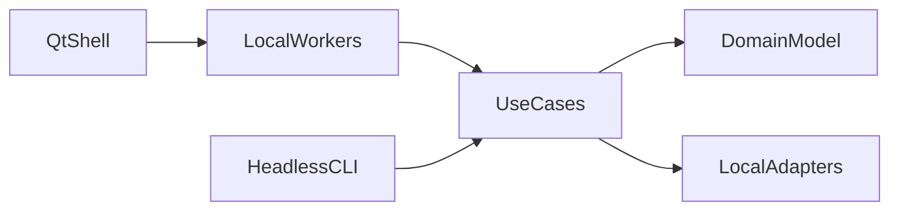

# Architecture

- Status: Draft for review
- Phase: P0 (logical structure only; no module code)
- Glossary: [DATA_MODEL.md](DATA_MODEL.md#glossary)
- Open-question index: [OPEN_QUESTIONS.md](OPEN_QUESTIONS.md)

## Context

The workbench is a local desktop application. Scholars import scans, inspect ranked hypotheses, and record validation decisions. P0 describes the structure those later phases will implement. It does not add a package, a Qt shell, or a network client.

## Non-goals

P0 does not choose a persistence engine, an HTR runtime, a geometry library, or an image library. Those choices are [Q-ENG-01](#q-eng-01) and [Q-ENG-03](#q-eng-03) through [Q-ENG-05](#q-eng-05). Packaging is [Q-ENG-02](#q-eng-02), closed by [P1-01](../tasks/P1-01.md). The default process has no network client. See [ADR-0001](adr/0001-local-only-processing.md).

## Layering



- **Qt shell.** Presents hypotheses, epistemic class, and text status. It shows rank inside one hypothesis type and one channel. It never displays a cross-type total order. It does not run detection, search, or HTR on the UI thread. [ADR-0005](adr/0005-qt-shell-and-headless-core.md).
- **Headless CLI.** Calls the same use cases as the shell. Benchmarks and ingest can run without Qt.
- **Local workers.** Run expensive use cases off the UI thread. Thread versus process is [Q-ENG-06](#q-eng-06).
- **Use cases.** Import, verify, detect, rank joins, assemble, recognize text, score language, record decisions, and export.
- **Domain model.** Entities in [DATA_MODEL.md](DATA_MODEL.md). Hypothesis ranking and epistemic class live here.
- **Local adapters.** Filesystem project store, image reading, and a future HTR runtime. Adapters do not open network connections unless a later approval says so.

## Future package boundaries

The import package is `prw` (distribution `parchment-workbench`). The minimum Python version is 3.12. See [Q-ENG-02](#q-eng-02). Boundaries inside that package:

| Boundary | Responsibility |
| --- | --- |
| `ingest` | Copy source bytes into the project store, compute and verify SHA-256, write sidecars and protocol exceptions. |
| `calibration` | Record scale observations and the transform between pixel and millimetre frames. |
| `fragments` | Fragment outlines and text-region geometry. |
| `joins` | Pairwise join hypotheses and the `physical` score channel. |
| `assemblies` | Top-N page placements in `page_global_mm`. |
| `htr` | Local Ancient Greek HTR, stored as text status `ocr_inferred`, class `interpretation`, producer `machine`. |
| `language` | The `language` score channel on hypotheses the physical search admitted. |
| `validation` | Append validation decisions and scholarly restorations. |
| `export` | Write an auditable bundle. |
| `store` | Read and write the project directory. Schema version lives here. |

Use cases call these boundaries. The Qt shell does not import algorithm modules except through a use case.

## Project directory

This layout is proposed under [Q-ENG-01](#q-eng-01) and [ADR-0007](adr/0007-project-persistence.md). It is not an accepted project format.

```text
project/
  manifest.json
  originals/
  observations/
  runs/
  validations/
  exports/
```

- `manifest.json` records project identity and `schema_version: 1`.
- `originals/` stores the authoritative immutable bytes under a content-addressed name derived from the SHA-256. After ingest, later reads use this copy. The path does not encode a join, a page, or a reading.
- `observations/` stores human observations and protocol exceptions.
- `runs/` stores algorithm runs, provenance envelopes, and hypotheses.
- `validations/` stores validation decisions and scholarly restorations.
- `exports/` stores bundles a scholar chose to write. Exports are generated files, not sources.

A path is an address. Scientific conclusions live in records, not in path segments.

## Threading and cancellation

The Qt UI thread paints, routes input, and displays progress. Detection, join search, assembly search, and HTR run on local workers. A run accepts a cancellation request and stops producing further hypotheses. Hypotheses already written stay written. Partial work is an algorithm run with `status: cancelled` or `status: failed`, not a silent abort. That row is written once. Its id includes an `attempt_id`, so a later completed run of the same inputs is a different row and can be stored beside it. Those partial hypotheses are excluded from the reproducibility claim and from ranking.

## Determinism

`code_version` is the git SHA of the producing code. A deterministic algorithm omits `random_seed`. An algorithm that uses randomness receives a seed in the request and copies it into the provenance envelope. A repeated completed call with the same algorithm name, source hashes, parameter hash, algorithm version, code version, model hash, and seed, including a matching absence of seed, produces the same ranked hypothesis content inside each `(run, hypothesis_type, channel)`, under the same completed-run id. The id array is defined in the [data model](DATA_MODEL.md#algorithmrun). A cancelled or failed call with those same inputs does not take that id. Calling an unseeded random generator is a defect.

## Dependency and license gate

A runtime dependency is added only with a documented reason and license, and only after implementation approval when the dependency implies a network download or a privacy-policy change. Image IO, geometry, and HTR runtimes are inside [Q-ENG-03](#q-eng-03), [Q-ENG-04](#q-eng-04), and [Q-ENG-05](#q-eng-05). P0 adds no dependencies.

## Error policy

- Checksum mismatch, missing bytes, and unsupported modalities fail the affected source visibly. A checksum mismatch is an `IntegrityFailure`. It is not observed evidence, and it produces no hypotheses for that source.
- Exceptions propagate with their cause. Bare swallowing is forbidden.
- A use case returns a real result or a structured failure. It does not return a placeholder outline, a fake reading, or an empty success.
- The default process does not embed a network client.

## Which ADR owns each structural choice

| Choice | ADR | Status |
| --- | --- | --- |
| No network in the default process | [0001](adr/0001-local-only-processing.md) | Accepted |
| Three coordinate frames | [0002](adr/0002-three-coordinate-frames.md) | Accepted |
| Epistemic classes and ranked hypotheses | [0003](adr/0003-evidence-classes-and-ranked-hypotheses.md) | Accepted |
| Immutable sources and provenance | [0004](adr/0004-immutable-sources-and-provenance.md) | Accepted |
| Qt shell, headless core, off-thread work | [0005](adr/0005-qt-shell-and-headless-core.md) | Accepted |
| Append-only hypotheses | [0006](adr/0006-append-only-hypotheses.md) | Accepted |
| Project persistence | [0007](adr/0007-project-persistence.md) | Proposed |
| Rigid rectangular page | [0008](adr/0008-rigid-rectangular-page.md) | Proposed |
| Separate score channels | [0009](adr/0009-separate-score-channels.md) | Proposed |
| Local Greek HTR runtime | [0010](adr/0010-local-greek-htr-runtime.md) | Proposed, blocked |
| Frame conventions | [0011](adr/0011-frame-conventions.md) | Accepted |
| Export types | [0012](adr/0012-export-types.md) | Accepted |
| Human outline correction | [0013](adr/0013-human-outline-correction.md) | Accepted |

## Open questions

### Q-ENG-01

Content-addressed files, SQLite, or both?

The store is the project format. Changing it later requires a migration and stop-and-ask.

- Options: a directory of content-addressed files plus JSON records; a single SQLite database with originals stored as files beside it; SQLite for records and content-addressed files for originals, which is the layout sketched above.
- Blocks: accepting a project format. P1 may implement a store only after this question is closed, or must keep the implementation behind a decision that answers it.

### Q-ENG-02

What is the minimum Python version and the packaging layout?

Closed by [P1-01](../tasks/P1-01.md). No ADR: the question does not touch evidence semantics, project format, a public API, or privacy policy. Minimum Python is 3.12. The layout is `src/`. The distribution name is `parchment-workbench`. The import package is `prw`.

- Blocks: nothing further for packaging. Image ingest remains blocked by [Q-ENG-05](#q-eng-05). A project format remains blocked by [Q-ENG-01](#q-eng-01).

### Q-ENG-03

HTR runtime: ONNX Runtime, PyTorch, or an external local binary?

The runtime is a dependency with a license, a distribution size, and a possible network installer. No runtime is approved.

- Options: ONNX Runtime; PyTorch; an external local binary invoked without a network call; defer HTR until P5.
- Blocks: P5, together with [Q-SCI-14](adr/0010-local-greek-htr-runtime.md). See [ADR-0010](adr/0010-local-greek-htr-runtime.md).

### Q-ENG-04

Geometry library versus an in-house implementation, including license?

Join and assembly geometry need robust polygons. A library adds a license obligation.

- Options: an in-house implementation of the rigid operations the algorithm contract needs; a documented geometry library chosen with its license at implementation time.
- Blocks: P3 and P4 implementation choices. The algorithm contract does not name a library.

### Q-ENG-05

Which TIFF and image libraries are allowed, including license?

Source images are lossless TIFF. Reading them without rewriting bytes is an ingest requirement.

- Options: the Python standard library where it is sufficient; a documented TIFF library chosen with its license at implementation time.
- Blocks: P1 image ingest. P0 does not select a library.

### Q-ENG-06

Worker thread or worker process for expensive jobs?

[ADR-0005](adr/0005-qt-shell-and-headless-core.md) requires work off the UI thread. It does not choose the isolation mechanism. A process crash can leave the shell up. A thread shares memory and needs a stricter cancellation story.

- Options: a worker thread; a worker process that calls the same use-case entry points as the CLI; either, chosen per job class.
- Blocks: P7 worker implementation. P1 CLI work can run in the foreground process.
