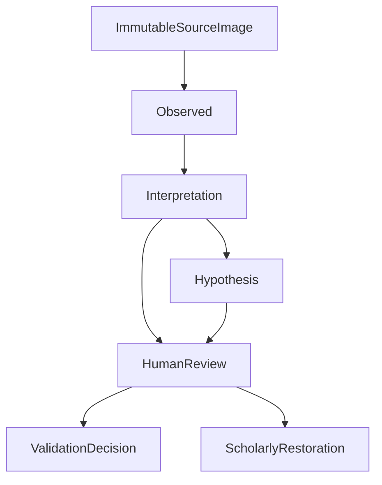

# Data model

- Status: Draft for review
- Phase: P0
- Schema version: `1` (described; stored in `manifest.json` when a project exists)
- Open-question index: [OPEN_QUESTIONS.md](OPEN_QUESTIONS.md)

A stored project writes `schema_version: 1` in `manifest.json`. A later change is a migration from version `1`, with migration tests. Persistence of the directory layout remains [Q-ENG-01](ARCHITECTURE.md#q-eng-01) and [ADR-0007](adr/0007-project-persistence.md). The byte rule is already decided: after ingest, the `originals/` copy is the authoritative byte source.

Every timestamp is UTC ISO-8601. Timestamps are metadata. They are never an input to an id. A hash value is `sha256:` followed by lowercase hexadecimal. The prefix is the algorithm identifier. Where a hash does not apply, the stored token is `absent`. An empty string is not a hash value.

Every content-derived id is a UUIDv5 as in RFC 4122. The namespace is the URL namespace `6ba7b811-9dad-11d1-80b4-00c04fd430c8`. The name is canonical JSON, UTF-8, with sorted object keys and no insignificant whitespace. When the id field names an ordered list of inputs, the JSON value is that array, in the order written there. When the id field says canonical content, the JSON value is the object of that row's stored fields except `id`. An omitted field is absent from that object. It is not stored as null. Timestamps are not inputs to either form.

A completed `AlgorithmRun.id` is that UUIDv5 over this array: `completed`, `algorithm_name`, `algorithm_version`, `code_version`, `parameter_hash`, `model_hash`, the source hashes sorted lexicographically, and the seed or the token `absent`. `model_hash` in that array is `sha256:` plus lowercase hexadecimal, or `absent`. A cancelled or failed run uses the same array with its status word in place of `completed`, and with `attempt_id` inserted after the status word. `attempt_id` is a random UUID stored only on that non-completed run. It is not part of the reproducibility key. A later completed run of the same inputs has a different id, and the failed row stays stored. A second completed execution of the same inputs reproduces the completed id and does not insert another row. Timestamps are not in the array. The row is written once with its final status. Status is not rewritten.

A derived row whose id includes a run stores that `run_id` on the row. A derived row with no run omits the run id from its id input. Random UUIDs are only for sessions, validation decisions, status events, protocol events, and the `attempt_id` of a non-completed run. They are never the id of a derived artifact.

A value that is a position, a length, or a polygon names its `CoordinateFrame`. Frames are never mixed in one field. Frames name coordinate systems. They do not store transforms. Transforms live on placements and on calibrations.

Hypothesis content rows are immutable. See [ADR-0006](adr/0006-append-only-hypotheses.md). A revision creates a new id and a `supersedes_id` link. Existing rows stay. Status is an append-only `StatusEvent` stream. The current status is the latest event. It is not a column on the hypothesis row.

## Glossary

This is the only glossary in the repository. Other documents use these terms and link here.

- **Source image.** The immutable scan bytes, addressed by their SHA-256.
- **Derivative.** A new file produced from a source image. It cites the source hash and does not replace the source.
- **Fragment.** The identity of one physical piece in a project. A label on a fragment does not encode a reconstruction. A fragment is not ranked.
- **Outline revision.** A polygon for a fragment boundary in a named frame. The stored type is `FragmentOutlineRevision`.
- **Edge arc.** A stable edge on one outline revision, with geometry in `fragment_local_mm`.
- **Join hypothesis.** A proposed contact between two edge arcs, with a rigid pose and score channels. The stored type is `JoinHypothesis`.
- **Assembly hypothesis.** A proposed placement of several fragments in the one shared page frame.
- **Reading.** A sequence of graphemes attached to a fragment or an assembly. The stored type is `ReadingHypothesis`. The epistemic class is `interpretation`.
- **Text line.** A detected baseline and region. The stored type is `TextLineHypothesis`. The epistemic class is `interpretation`.
- **Epistemic class.** One of `observed`, `interpretation`, or `hypothesis`.
- **Text status.** One of `human_read`, `unclear`, and `ocr_inferred`. This vocabulary is not the epistemic class. The decision name `human_validated` is not a text status. `missing` is not a grapheme status. Supplied text is not a grapheme status.
- **Validation decision.** An accept, reject, or defer recorded against a hypothesis id.
- **Provenance envelope.** Source hashes, the full parameter blob and its SHA-256, algorithm name and version, model hash, random seed when the algorithm is not deterministic, code version, and decoder name and version.
- **Coordinate frame.** `source_pixels`, `fragment_local_mm`, or `page_global_mm`, with the origin, axes, and unit fixed by [ADR-0011](adr/0011-frame-conventions.md).
- **Score channel.** One of `physical`, `htr`, or `language`. A channel is an uncalibrated ranking feature unless a later evaluation shows otherwise.
- **Working assumption.** A labeled premise the documents use so they stay coherent. It is not a decision.
- **Open question.** A product, scientific, privacy, or engineering choice that P0 leaves unresolved.

### Epistemic classes

- **Observed.** Physical measurements bound to source bytes: pixels, calibration, and fragment extent. Never a reading. Never a placement.
- **Interpretation.** Readings and measurements derived from observation: OCR readings, human letter readings, detected outlines, and detected lines. Producer is a separate field.
- **Hypothesis.** Reconstruction proposals: joins, assemblies, placements, and restorations. A human placing a fragment produces a hypothesis with `producer: human`.

### Text status and epistemic class

| Text status | Where it sits |
| --- | --- |
| `human_read` | A human letter reading. Epistemic class `interpretation`. |
| `unclear` | Interpretation. The reading is not secure. |
| `ocr_inferred` | Interpretation. This stored name covers HTR output. Renaming it to `htr_inferred` is an evidence-semantics change and is not made here. |
| `human_validated` | A decision record, not an epistemic class. Acceptance does not re-type the reading. |

`human_validated` stays part of the required vocabulary. The stored grapheme keeps its underlying text status and its class `interpretation`. A `ValidationDecision` points at that grapheme or at a larger hypothesis. The UI may show that a decision exists. Replacing `ocr_inferred` with `human_validated` would drop the underlying status, so the stored schema does not do that. Accepting a machine reading does not change its class or its text status.

### Greek text storage

Decided for storage now. The full Greek-policy ADR is deferred to Phase 5. What remains open is [Q-SCI-04](ALGORITHM.md#q-sci-04).

A reading carries `script` and `language` tags. Grapheme text and supplied restoration text are stored in Unicode NFC. Comparison and matching may strip accents and normalize final sigma. Storage never does. Nomina sacra, abbreviations, and mixed-script pages are not forced through a Greek-only reading.

## Score channels

A scored join, assembly, or reading stores every channel its run computed:

- `physical` for geometric join and assembly features
- `htr` for the recognition model's ranking feature
- `language` for the language-scoring feature

Each stored score is a number plus `score_context`:

| Field | Required content |
| --- | --- |
| `value` | The ranking feature |
| `run_id` | The run that computed it |
| `channel` | `physical`, `htr`, or `language` |
| `hypothesis_type` | `join`, `assembly`, or `reading` |

Scores are incomparable across runs, across algorithms, and across hypothesis types. Rank exists only inside one triple `(run, hypothesis_type, channel)`. A single run never ranks mixed types in one order. The UI never displays a cross-type total order. Fragments have identification status and have no rank.

Rank is not a stored column. It is derived when a list is read. Inside one triple, consider only hypotheses that have a score in that channel, that either have no run or whose run status is `completed`, and whose current status is not `invalidated`. A higher score ranks first. Equal scores are ordered by the content-derived hypothesis id, ascending bytewise. A contested assembly stays in that order. An invalidated row is omitted. Filling a rank never writes the hypothesis row, and rank is not an input to its id.

Fusion of channels is [Q-SCI-09](ALGORITHM.md#q-sci-09) and [ADR-0009](adr/0009-separate-score-channels.md). Propagating calibration uncertainty into `physical` scores is a Phase 6 requirement. P0 records the requirement and does not implement it.

## Forbidden fields

No entity in the project evidence database defines a field named `truth`, `correct_join`, `original_text`, or unlabeled `confidence`. Benchmark labels are the exception, and they live only in the `BenchmarkLabel` store under `benchmarks/`, never in the project database. Solver code paths never read that store. See [EVALUATION.md](EVALUATION.md#benchmarklabel).

## Entities

### SourceImage

Observed evidence. Pixels are immutable. The product rule is a lossless TIFF. Current ingest accepts the 4-byte TIFF magic `II*\x00` or `MM\x00*` and records media type `image/tiff`. Any other prefix is rejected. The fixture reader enforces the uncompressed grayscale layout used by the synthetic writer. A general lossless-TIFF decoder stays behind [Q-ENG-05](OPEN_QUESTIONS.md#q-eng-05). After ingest, the bytes in `originals/` are the authoritative source. Later reads use that copy.

| Field | Required content |
| --- | --- |
| `id` | UUIDv5 over the content hash |
| `content_hash` | `sha256:` and the hexadecimal digest of the immutable bytes |
| `byte_length` | Length of those bytes |
| `media_type` | `image/tiff`. Current ingest enforces the 4-byte magic. The fixture reader enforces the uncompressed grayscale layout |
| `pixel_width`, `pixel_height` | Dimensions in pixels |
| `fragment_id` | Fragment this capture belongs to. Two captures of one fragment are two rows, linked by this id and `face` |
| `claimed_resolution_ppi` | Header or operator claim. The importer warns and leaves calibration null. It never populates calibration |
| `face` | `recto`, `verso`, or `unknown`. This is the face of this capture |
| `group_scan` | True when more than one fragment is in the frame. A fact about the capture. Not a confidence value, and not a second epistemic class |
| `color_space` | Color space label from the file or the sidecar |
| `color_profile_ref` | Reference to the color-profile sidecar, when one exists |
| `protocol_version` | Scan-protocol version the capture claims to follow |
| `storage_path` | Location of the authoritative bytes inside `originals/` |

`claimed_resolution_ppi` is not a measurement. When it is the only scale information, the importer warns and leaves `CalibrationObservation` null. The warning is a `ProtocolException`. It does not create a scale row.

### ProtocolException

A protocol event that a capture deviated from the [scan protocol](SCAN_PROTOCOL.md). It does not modify the source image. It does not enter the evidence pool. A checksum mismatch is an `IntegrityFailure`, which is also a protocol event and also stays out of the evidence pool.

| Field | Required content |
| --- | --- |
| `id` | Random UUID |
| `source_image_id` | Source the exception qualifies |
| `rule_id` | Protocol rule that failed or was waived |
| `description` | What was observed about the deviation |
| `recorded_by` | Actor, subject to [Q-PRI-02](SECURITY_AND_PRIVACY.md#q-pri-02) |
| `recorded_at` | UTC ISO-8601 timestamp |

### IntegrityFailure

A protocol event for a checksum mismatch. It is not observed evidence, and it never enters the evidence pool. Same rule as `ProtocolException`: a protocol event, not an evidence row.

| Field | Required content |
| --- | --- |
| `id` | Random UUID |
| `source_image_id` | Source image the failure qualifies |
| `presented_hash` | `sha256:` digest of the bytes that were presented |
| `expected_hash` | `sha256:` digest that was recorded for that source |
| `timestamp` | UTC ISO-8601 timestamp of the mismatch |

### CalibrationObservation

Scale evidence for one source image: pixels per millimetre, an uncertainty, and the producer of the measurement. Calibration is `observed`. The class stays `observed` for `human`, `machine`, and `imported`. Producer does not re-type the row.

| Field | Required content |
| --- | --- |
| `id` | UUIDv5 over the canonical content of this record |
| `source_image_id` | Source the scale applies to |
| `producer` | `human`, `machine`, or `imported` |
| `epistemic_class` | `observed` |
| `pixels_per_mm` | Scale value. Never copied from `claimed_resolution_ppi` |
| `uncertainty` | Stated uncertainty, in the same scale units |
| `evidence_description` | Which target or measurement the value comes from |
| `frame_id` | The `source_pixels` frame the pixels refer to |
| `transform_id` | The `CalibrationTransform` for this source image |
| `provenance_id` | Envelope when the producer is `machine` |

### CalibrationTransform

A similarity for one source image only: rotation, translation, and one uniform scale, from `source_pixels` into millimetres. Placements do not carry this scale.

| Field | Required content |
| --- | --- |
| `id` | UUIDv5 over the canonical content of this record |
| `source_image_id` | The only image this transform applies to |
| `from_frame_id` | The `source_pixels` frame |
| `to_frame_id` | The `fragment_local_mm` frame |
| `rotation_radians` | Rotation |
| `translation_x`, `translation_y` | Translation in millimetres |
| `uniform_scale` | Pixels per millimetre, one scale for both axes |
| `producer` | `human`, `machine`, or `imported` |
| `epistemic_class` | `observed` |

### DiagnosticRecord

A free affine fit. It is stored so the fit can be audited. It is never used for placement, and it never enters the ranking pool.

| Field | Required content |
| --- | --- |
| `id` | UUIDv5 over the run id when `run_id` is set, then the source image id and the coefficients. When `run_id` is null, over the source image id and the coefficients |
| `source_image_id` | Image the fit was computed on |
| `coefficients` | The affine coefficients |
| `producer` | `human`, `machine`, or `imported` |
| `run_id` | Null when `producer` is `human`. Set when a run produced the row. When it is set, the id includes it |
| `operator_id` | Set when `producer` is `human` |
| `session_id` | Set when `producer` is `human` |
| `epistemic_class` | `interpretation` |
| `provenance_id` | Envelope when a machine produced it |

### CoordinateFrame

| Field | Required content |
| --- | --- |
| `id` | UUIDv5 over the canonical content of this record |
| `kind` | `source_pixels`, `fragment_local_mm`, or `page_global_mm` |
| `origin_description` | The origin from [ADR-0011](adr/0011-frame-conventions.md). Top-left pixel, first-outline centroid, or minimum page corner |
| `axis_x_direction`, `axis_y_direction` | `+x` right, `+y` down, for all three kinds |
| `unit` | `px` for `source_pixels`, `mm` for the millimetre frames |
| `owner_id` | Source image, fragment, or the project page frame |
| `establishing_outline_revision_id` | Set only for `fragment_local_mm`. The outline revision whose polygon centroid is the origin. Not updated when that revision is superseded |

`source_pixels` is owned by one source image. Its origin is the top-left pixel. `fragment_local_mm` is owned by one fragment, and it does not exist until the establishing outline revision exists. Its origin is the area centroid of the polygon cited by `establishing_outline_revision_id`. A repeated closing vertex is not a second vertex. That citation does not change. The mask is that polygon. It is not a `FragmentExtent`. `page_global_mm` is owned by the project, through the one `PageFrame`. Its origin is the corner with the smallest x and the smallest y, at coordinate (0, 0). Width and height ranges are measured from that origin. An assembly does not own a page frame. Origin and axes are [ADR-0011](adr/0011-frame-conventions.md). The fields on this row repeat that decision. They do not choose a different origin. [Q-SCI-11](OPEN_QUESTIONS.md#q-sci-11) and [Q-SCI-12](OPEN_QUESTIONS.md#q-sci-12) are closed.

### PageFrame

One shared page frame per project. Every assembly places fragments in this frame, so hypotheses are comparable. Width and height are ranges, not point values.

| Field | Required content |
| --- | --- |
| `id` | UUIDv5 over the canonical content of this record |
| `frame_id` | The project's `page_global_mm` frame |
| `min_width_mm`, `max_width_mm` | Inclusive width range |
| `min_height_mm`, `max_height_mm` | Inclusive height range |

The origin is the corner with the smallest x and the smallest y, and that corner is coordinate (0, 0), under [ADR-0011](adr/0011-frame-conventions.md). The width and height ranges are measured from that origin and do not move it. How the numbers in the ranges are chosen remains [Q-SCI-02](ALGORITHM.md#q-sci-02). Replacing the ranges writes a new `PageFrame`. Assemblies keep the id they were scored against.

### RigidTransform

A rigid pose: rotation and translation only. Every placement uses this type. Uniform scale is not a field of a placement. It lives on `CalibrationTransform`.

| Field | Required content |
| --- | --- |
| `id` | UUIDv5 over the canonical content of this record |
| `from_frame_id`, `to_frame_id` | Frames. The destination of a placement is the shared page frame |
| `rotation_radians` | Rotation |
| `translation_x`, `translation_y` | Translation in the destination unit |
| `producer` | `human`, `machine`, or `imported` |
| `epistemic_class` | `hypothesis`. A person who placed the fragment sets `producer` to `human` |
| `provenance_id` | Envelope for a machine pose |

### Fragment

Identity of a physical piece. The label is an inventory label, not a conclusion.

| Field | Required content |
| --- | --- |
| `id` | UUIDv5 over the project identity and the catalog label |
| `label` | Opaque label |
| `identification_status` | `catalogued` (from an owner inventory or manifest), `detected` (machine-proposed), or `confirmed` (human-reviewed detection) |

Only `catalogued` and `confirmed` fragments enter matching by default. A fragment has no `face` field. Face is the capture's face, on `SourceImage`. Two captures of one fragment are two `SourceImage` rows with the same `fragment_id` and their own `face`. Face constraints on assembly are [Q-PRD-03](PRD.md#q-prd-03).

### FragmentExtent

Observed extent of a physical piece, bound to source bytes. A detector polygon is not this row.

| Field | Required content |
| --- | --- |
| `id` | UUIDv5 over the canonical content of this record |
| `fragment_id` | Fragment |
| `source_image_id` | Bytes the extent is bound to |
| `frame_id` | Frame of the geometry |
| `geometry` | The measured extent |
| `producer` | `human`, `machine`, or `imported` |
| `epistemic_class` | `observed` |
| `provenance_id` | Envelope when the producer is `machine` |

A human correction of a detector outline is not this row. It is a new `FragmentOutlineRevision` ([ADR-0013](adr/0013-human-outline-correction.md)).

### FragmentOutlineRevision

A polygon in a named frame, with its producer and epistemic class. A detector outline is `interpretation` with `producer: machine`. A human correction of that outline is a new row in class `interpretation` with `producer: human`, a null `run_id`, and `operator_id` and `session_id` set. `supersedes_id` cites the machine revision. That revision stays. The correction is not a `FragmentExtent` ([ADR-0013](adr/0013-human-outline-correction.md)). Each row is one revision. Superseding writes a new row and a `supersedes_id` link. The previous row stays. The outline revision cited as `establishing_outline_revision_id` on that fragment's `fragment_local_mm` frame fixes the origin. Later revisions do not move the origin. Their polygons are stored in the existing frame.

| Field | Required content |
| --- | --- |
| `id` | UUIDv5 over the run id and the polygon when `run_id` is set. When `run_id` is null, over `fragment_id`, `supersedes_id`, `operator_id`, `session_id`, and the polygon |
| `fragment_id` | Fragment |
| `frame_id` | Frame of the polygon |
| `polygon` | Ordered vertices in that frame |
| `producer` | `human`, `machine`, or `imported` |
| `run_id` | Null when `producer` is `human`. Set when a run produced the row. When it is set, the id includes it |
| `operator_id` | Set when `producer` is `human` |
| `session_id` | Set when `producer` is `human` |
| `epistemic_class` | `interpretation` |
| `provenance_id` | Envelope when a machine produced it |
| `supersedes_id` | Previous revision id, when this row is a revision |

Superseding a revision appends a `StatusEvent` of `invalidated` on its `EdgeArc` rows and on the join candidates that cite those edges. The content rows are not rewritten and are not deleted. Invalidated rows drop out of ranking.

### EdgeArc

A first-class edge. The id is stable for one `FragmentOutlineRevision`. Geometry is always in `fragment_local_mm`.

| Field | Required content |
| --- | --- |
| `id` | UUIDv5 over the run id when `run_id` is set, then the outline revision id and the edge geometry. When `run_id` is null, over the outline revision id and the edge geometry |
| `outline_revision_id` | The revision that owns this edge |
| `frame_id` | The fragment's `fragment_local_mm` frame |
| `geometry` | The edge geometry in that frame |
| `producer` | `human`, `machine`, or `imported` |
| `run_id` | Null when `producer` is `human`. Set when a run produced the row. When it is set, the id includes it |
| `operator_id` | Set when `producer` is `human` |
| `session_id` | Set when `producer` is `human` |
| `epistemic_class` | `interpretation` |
| `provenance_id` | Envelope when a machine produced it |

### JoinHypothesis

A join candidate: a proposed contact between two edge arcs. The pose is a `RigidTransform`. The epistemic class is `hypothesis`.

| Field | Required content |
| --- | --- |
| `id` | UUIDv5 over the run id and the hypothesis content when `run_id` is set. A human proposal with no run uses the row content alone |
| `run_id` | Null for a human proposal. Set when a run produced the row. When it is set, the id includes it |
| `fragment_a_id`, `edge_a_id` | First edge arc |
| `fragment_b_id`, `edge_b_id` | Second edge arc |
| `transform_id` | Relative rigid pose |
| `producer` | `human`, `machine`, or `imported` |
| `scores` | Score values with `score_context` |
| `provenance_id` | Envelope |

The row has no status column. Whether a hypothesis may name three fragments at once is [Q-SCI-07](ALGORITHM.md#q-sci-07). This schema describes pairwise joins.

### AssemblyHypothesis

Placements of fragments in the project's one `page_global_mm` frame. The epistemic class is `hypothesis`.

| Field | Required content |
| --- | --- |
| `id` | UUIDv5 over the run id and the hypothesis content when `run_id` is set. Otherwise over the row content |
| `run_id` | Null for a human assembly. Set when a run produced the row. When it is set, the id includes it |
| `page_frame_id` | The project `PageFrame`. Every assembly in the project cites this same id |
| `join_ids` | The join candidates this assembly contains |
| `placements` | Fragment id, outline revision id, and rigid transform id for each placed fragment |
| `unplaced_fragment_ids` | Fragments in the search that this assembly did not place |
| `producer` | `human`, `machine`, or `imported` |
| `scores` | Score values with `score_context` |
| `provenance_id` | Envelope |

`contested` is a `StatusEvent`, appended when a contained join's current status is `rejected` or `rejected-via-ValidationDecision`. The assembly row is not rewritten. A contested assembly stays in its rank list. Page size is the project frame's dimension ranges, not a point value on the assembly, until [Q-SCI-02](ALGORITHM.md#q-sci-02) says how those ranges are chosen. A rigid rank penalty for mismatch to those ranges is a known limitation of this model. Anisotropic shrinkage and cockling are deferred with [Q-SCI-03](ALGORITHM.md#q-sci-03) and [Q-SCI-20](ALGORITHM.md#q-sci-20).

### GapRegion

A gap on a page hypothesis. Geometry, extent, and uncertainty. This is not a grapheme status. The epistemic class is `hypothesis`. When a run produced the gap, `run_id` is stored, and the id includes it.

| Field | Required content |
| --- | --- |
| `id` | UUIDv5 over the run id, the assembly id, and the gap content when `run_id` is set. Otherwise over the assembly id and the gap content |
| `run_id` | Null for a human gap. Set when a run produced the row. When it is set, the id includes it |
| `assembly_id` | Page hypothesis this gap belongs to |
| `geometry` | Geometry of the gap |
| `extent` | Extent of the gap |
| `uncertainty` | Stated uncertainty of the extent |
| `frame_id` | The shared page frame |
| `producer` | `human`, `machine`, or `imported` |
| `epistemic_class` | `hypothesis` |

### TextLineHypothesis

A detected line. The baseline polyline and the region are in `fragment_local_mm`. This row stores no order index. The epistemic class is `interpretation`.

| Field | Required content |
| --- | --- |
| `id` | UUIDv5 over the run id and the line geometry when `run_id` is set. Otherwise over the geometry |
| `run_id` | Null when `producer` is `human`. Set when a run produced the row. When it is set, the id includes it |
| `operator_id` | Set when `producer` is `human` |
| `session_id` | Set when `producer` is `human` |
| `fragment_id` | Fragment |
| `outline_revision_id` | Outline the line was detected on |
| `frame_id` | The `fragment_local_mm` frame |
| `baseline` | Polyline in that frame |
| `region` | Region in that frame |
| `producer` | `human`, `machine`, or `imported` |
| `epistemic_class` | `interpretation` |
| `provenance_id` | Envelope when a machine produced it |

The line row stores no order index.

### TextLineOrder

The order of lines on one fragment. Order is a ranked list of alternative sequences of `TextLineHypothesis` ids. The line rows are created first, so this id does not define the line ids it cites. The epistemic class is `interpretation`.

| Field | Required content |
| --- | --- |
| `id` | UUIDv5 over the run id when `run_id` is set, then the cited line ids and the alternative sequences. When `run_id` is null, over the cited line ids and the alternative sequences |
| `fragment_id` | Fragment |
| `order_alternatives` | Ranked sequences of line ids. There is no single order index |
| `producer` | `human`, `machine`, or `imported` |
| `run_id` | Null when `producer` is `human`. Set when a run produced the row. When it is set, the id includes it |
| `operator_id` | Set when `producer` is `human` |
| `session_id` | Set when `producer` is `human` |
| `epistemic_class` | `interpretation` |
| `provenance_id` | Envelope when a machine produced it |

### ReadingHypothesis

A token sequence of grapheme ids, attached to a fragment or an assembly, with `htr` and `language` channels when those stages ran. The reading is `interpretation`. A scholar's reading has `producer: human`, a null `run_id`, and `operator_id` plus `session_id`.

| Field | Required content |
| --- | --- |
| `id` | UUIDv5 over the run id and the reading content when `run_id` is set. Otherwise over the reading content |
| `run_id` | Null when `producer` is `human`. Set when a run produced the row. When it is set, the id includes it |
| `operator_id` | Set when `producer` is `human` |
| `session_id` | Set when `producer` is `human` |
| `anchor_id` | Fragment id or assembly id |
| `grapheme_ids` | Ordered sequence |
| `script` | Script tag |
| `language` | Language tag |
| `producer` | `human`, `machine`, or `imported` |
| `epistemic_class` | `interpretation` |
| `scores` | Score values with `score_context`. Absent for a human reading that was not scored |
| `provenance_id` | Envelope when a machine produced it |

### GraphemeHypothesis

| Field | Required content |
| --- | --- |
| `id` | UUIDv5 over the run id when `run_id` is set, then the parent reading id and the grapheme content. When `run_id` is null, over the parent reading id and the grapheme content |
| `reading_id` | Parent reading |
| `text` | The grapheme, stored in Unicode NFC, or an empty reading |
| `text_status` | `human_read`, `unclear`, or `ocr_inferred` |
| `epistemic_class` | `interpretation` |
| `ink_region_frame_id` | Frame of the ink region |
| `ink_region` | Geometry of the region in that frame |
| `producer` | `human`, `machine`, or `imported` |
| `run_id` | Null when `producer` is `human`. Set when a run produced the row. When it is set, the id includes it |
| `operator_id` | Set when `producer` is `human` |
| `session_id` | Set when `producer` is `human` |

`missing` is not a grapheme status. A gap is a [GapRegion](#gapregion) on a page hypothesis. Show-through is [Q-SCI-06](#q-sci-06).

### ValidationDecision

Append-only under [ADR-0006](adr/0006-append-only-hypotheses.md). Recording a decision does not delete other hypotheses and does not rewrite their stored fields.

| Field | Required content |
| --- | --- |
| `id` | Random UUID |
| `target_hypothesis_id` | Hypothesis or grapheme the actor judged |
| `actor` | Who decided |
| `decided_at` | UTC ISO-8601 timestamp. Not hashed |
| `decision` | `accept`, `reject`, or `defer` |
| `comment` | Optional note |

An `accept` decision is what the vocabulary calls `human_validated`. The target keeps its epistemic class and its underlying text status. Accepting a machine reading does not re-type it.

These rules are application-service invariants. A `reject` decision appends a `StatusEvent` of `rejected-via-ValidationDecision` on the target. It does not rewrite the target. Accepting an assembly is blocked if any contained join's current status is `rejected` or `rejected-via-ValidationDecision`. Rejecting a join appends `contested` on every assembly whose `join_ids` contain it. A scholarly restoration cites only hypotheses whose current status is not rejected and not contested.

### StatusEvent

Append-only. Hypothesis content rows do not store status. Every `JoinHypothesis`, `AssemblyHypothesis`, `ReadingHypothesis`, `GraphemeHypothesis`, `FragmentOutlineRevision`, and `EdgeArc` is inserted with one `StatusEvent` in the same write. That event is `proposed`, unless the same write is a machine rejection, in which case the event is `rejected`. The current status is the `status` on the latest event for `target_id`. A row of those types with no event is not valid.

| Field | Required content |
| --- | --- |
| `id` | Random UUID. The timestamp is not hashed |
| `target_id` | Hypothesis the event qualifies |
| `status` | `proposed`, `rejected`, `rejected-via-ValidationDecision`, `contested`, or `invalidated` |
| `recorded_at` | UTC ISO-8601 timestamp |
| `actor` | The operator, or the run that appended the event |

### ScholarlyRestoration

Supplied content lives only here. It may reference `GapRegion` ids and existing grapheme ids. It has no `run_id` and is not an `AlgorithmRun` output. The epistemic class is `hypothesis`. The editorial convention is Leiden-style markers. The convention name is stored now. The marker text is filled at export time. Export types are [ADR-0012](adr/0012-export-types.md).

| Field | Required content |
| --- | --- |
| `id` | UUIDv5 over the restoration content |
| `supplied_content` | The restoration text or structured supply, stored in Unicode NFC |
| `editorial_convention` | `leiden`. The marker text is filled at export time |
| `gap_region_ids` | Gap regions this supply references |
| `grapheme_ids` | Existing grapheme ids this supply references |
| `cited_hypothesis_ids` | Hypotheses the restoration prefers. Each one must be non-rejected and not contested |
| `producer` | `human` or `imported`. `machine` is not a producer of this record |
| `epistemic_class` | `hypothesis` |
| `actor` | Author |
| `created_at` | UTC ISO-8601 timestamp |

### ScreeningEvent

A record that a hypothesis was admitted or excluded before a score existed. Exclusion is then distinguishable from a hypothesis that was never offered to the gate.

| Field | Required content |
| --- | --- |
| `id` | UUIDv5 over the run id, the hypothesis id, the gate, and the outcome |
| `hypothesis_id` | The hypothesis the gate saw |
| `gate` | `physical`, `language`, or `human` |
| `outcome` | `admitted` or `excluded` |
| `run_id` | The run that applied the gate |

### ProvenanceEnvelope

Required on every derived artifact once a stored schema exists. This document defines the fields.

| Field | Required content |
| --- | --- |
| `id` | UUIDv5 over the canonical content of this record |
| `source_hashes` | `sha256:` digest of each source image the artifact depends on |
| `parameter_blob` | Canonical JSON: sorted keys, UTF-8, no insignificant whitespace |
| `parameter_hash` | `sha256:` digest of `parameter_blob` |
| `algorithm_name` | Name of the algorithm |
| `algorithm_version` | Version of that algorithm |
| `model_hash` | `sha256:` digest of model weights, or the token `absent` when the run used no model. Never empty, and never omitted |
| `random_seed` | A JSON integer when the algorithm used randomness. Omitted when the algorithm is deterministic. The run-id array uses that integer, or the token `absent` |
| `code_version` | Git commit SHA of the producing code |
| `decoder_name` | Name of the image decoder that read the TIFF |
| `decoder_version` | Version of that decoder |

The same algorithm name, source hashes, parameter hash, algorithm version, code version, model hash, and seed (including a matching absence of seed) produce the same ranked hypothesis content. That claim applies only to a run whose status is `completed`. A non-completed run of those same inputs is a different row.

### AlgorithmRun

The grouping of hypotheses produced together. Partial hypotheses from a `cancelled` or `failed` run stay stored under that run's own id. They are excluded from the reproducibility claim and from ranking. The run id does not include `started_at`. A completed run and a non-completed run of the same inputs are two rows.

| Field | Required content |
| --- | --- |
| `id` | UUIDv5 over the array in the introduction. A completed run has no `attempt_id` in that array. A cancelled or failed run includes `attempt_id`. Timestamps are not hashed |
| `attempt_id` | Random UUID. Present only when `status` is `cancelled` or `failed`. Absent when `status` is `completed`. Not part of the reproducibility key |
| `provenance_id` | Envelope for the run |
| `join_ids` | Join ids produced. Their ranks are a separate order |
| `assembly_ids` | Assembly ids produced. Their ranks are a separate order |
| `reading_ids` | Reading ids produced. Their ranks are a separate order |
| `line_ids` | Text-line ids produced. Lines are not ranked with joins, assemblies, or readings |
| `line_order_ids` | `TextLineOrder` ids produced |
| `status` | `completed`, `cancelled`, or `failed` |
| `started_at` | UTC ISO-8601 timestamp. Metadata. Not part of the id |

## Open questions

### Q-SCI-06

How are bleed-through and show-through represented?

Ink from the opposite face can be segmented as text. The representation decides whether that ink is a reading on this face, a link to the other face, or a flagged region with no reading.

- Options: ignore show-through in the first reading model and treat it as a known failure; store a region flagged as possible show-through without a reading; register the two faces and attribute the ink to one of them.
- Blocks: the P5 reading model for opposite-face ink. The first algorithm contract names bleed-through as a failure mode and does not represent it as a reading.

### Q-SCI-13

What does a `GapRegion` denote: absent support, absent ink, or an editorial lacuna?

`missing` is not a grapheme status. A gap is a `GapRegion` on a page hypothesis, with geometry, extent, and uncertainty. These three situations remain different, and the stored schema does not store a separate status for each.

- **Absent support.** The parchment is physically missing.
- **Absent ink.** Support is present and no ink is visible.
- **Editorial lacuna.** An inference that text once stood in a gap. Supplied text for that gap lives on a `ScholarlyRestoration`, which may reference the `GapRegion`.

- Options: leave the `GapRegion` unlabeled as to which of the three it denotes; store that distinction on the `GapRegion`.
- Blocks: storing the distinction. P5 and P8 need a closed question before they emit lacunae as a distinct label. They do not emit a grapheme status `missing`.
